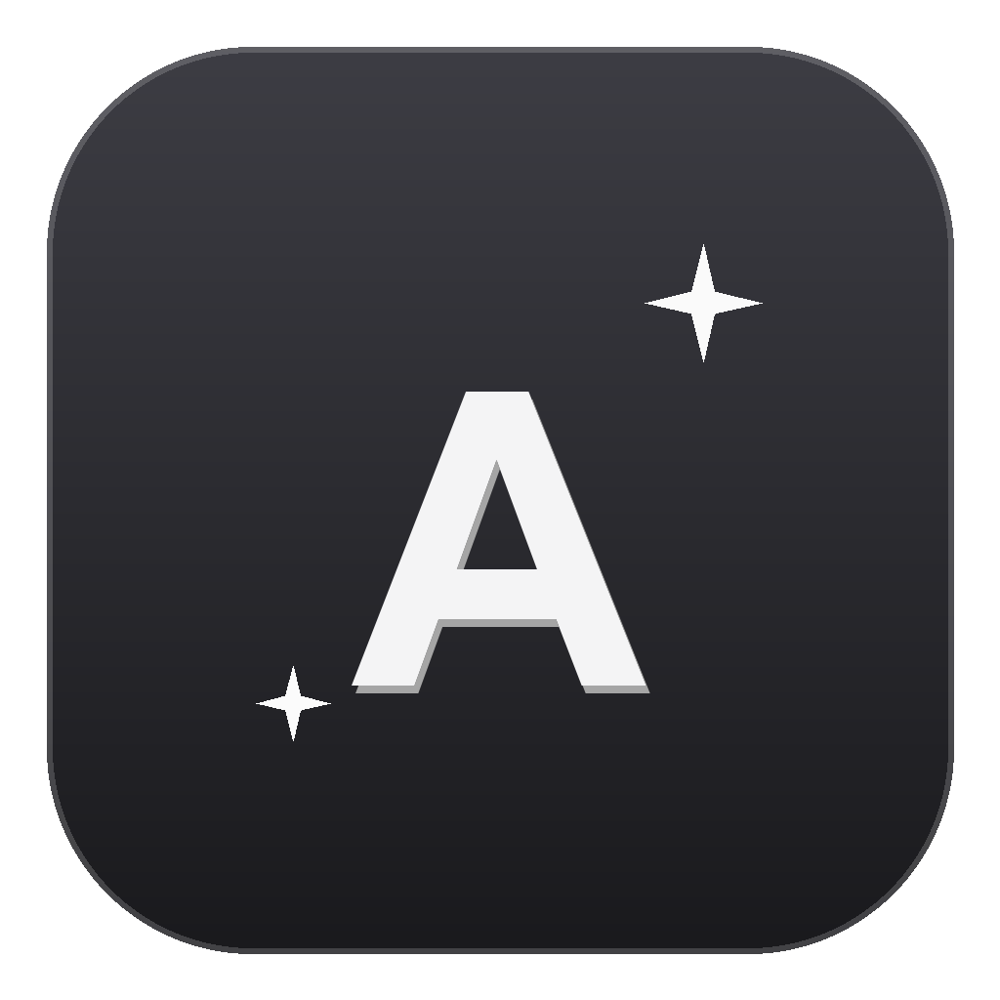

# Afnan • Fitness, Macros & Private Journal 🩶

A personal fitness tracker, macro & calorie counter, scratchpad notes, and password-protected encrypted journal app designed for macOS.



---

## Features

- 🩶 **Aesthetic Scandinavian Grey Theme**: Minimalist studio aesthetic by default, with easy toggle for Charcoal Slate, Rose Blush, Lavender Cloud, Matcha Sage, and Midnight Velvet.
- 🏋️‍♀️ **Gym & Workout Tracker**: Log exercises, dynamic sets, weights (kg/lbs), reps, and automatic personal record (🏆 PR) tracking.
- 🥗 **Calories & Macro Goals**: Set custom daily calorie and macro goals (Protein, Carbs, Fats), log meals with quick breakdown, and monitor visual live progress bars.
- 📝 **Personal Notes**: Instant local scratchpad with search, edit, and timestamping.
- 🔒 **Private Journal (Encrypted)**: Custom password protection with client-side **AES-GCM 256-bit + PBKDF2** encryption via Web Crypto API. Entries remain encrypted even in storage.
- 📁 **Backup & Restore**: One-click JSON export/import in Settings.

---

## Running Locally

```bash
# Install dependencies
npm install

# Start app in development mode
npm start

# Build macOS installer (.dmg and .zip)
npm run dist:mac
```

---

## Automatic GitHub Releases

Whenever you push a tag (e.g. `v1.0.0`) to GitHub, GitHub Actions will automatically compile the macOS `.dmg` and attach it to the Releases page so you can download it directly onto any Mac!
